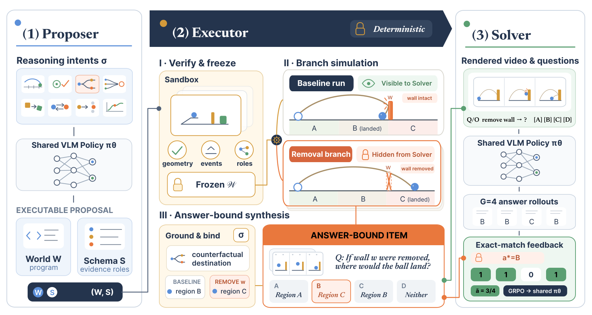

<div align="center">

<p></p>

[Jinyuan&nbsp;Hu](https://yelonhu.github.io/) · Yilei&nbsp;Jiang · Chen&nbsp;Tang · Minghong&nbsp;Cai · Xinran&nbsp;Liu · Xiangyu&nbsp;Yue

<p>
  <sub>Multimedia Laboratory, The Chinese University of Hong Kong</sub><br>
</p>

[](https://yelonhu.github.io/physevolve-page/) [][paper] [](https://huggingface.co/YelonLFT/physevolve-v7i-0851-step100) [](#quick-start) [](#training) [](#evaluation)

</div>

## Executable Worlds

Three reference scenes from the demonstration pool. Click a cover or **Play video** to open its MP4, or [watch all demos on the project page](https://yelonhu.github.io/physevolve-page/#scenes).

<table>
  <tr>
    <td align="center" valign="top" width="33%">
      <a href="https://yelonhu.github.io/physevolve-page/assets/throwing.mp4"></a><br>
      <strong>Throwing</strong><br>
      <sub>Ball trajectories through removable obstacles.</sub>
    </td>
    <td align="center" valign="top" width="33%">
      <a href="https://yelonhu.github.io/physevolve-page/assets/collision.mp4"></a><br>
      <strong>Collision</strong><br>
      <sub>Motion transfer through a chain of contacts.</sub>
    </td>
    <td align="center" valign="top" width="33%">
      <a href="https://yelonhu.github.io/physevolve-page/assets/motion.mp4"></a><br>
      <strong>Motion</strong><br>
      <sub>Rolling, sliding, and friction-dependent motion.</sub>
    </td>
  </tr>
  <tr>
    <td align="center"><a href="https://yelonhu.github.io/physevolve-page/assets/throwing.mp4">▶ Play video</a></td>
    <td align="center"><a href="https://yelonhu.github.io/physevolve-page/assets/collision.mp4">▶ Play video</a></td>
    <td align="center"><a href="https://yelonhu.github.io/physevolve-page/assets/motion.mp4">▶ Play video</a></td>
  </tr>
</table>

## Abstract

> Physical reasoning underpins how embodied systems understand and act in the physical world, yet vision-language models (VLMs) remain unreliable on questions about dynamics and physical causality. Progress is critically constrained by the scarcity of grounded counterfactual training data, as observational videos capture only the factual trajectory that occurred. The self-evolving paradigm offers a route beyond fixed datasets by enabling models to construct their own training problems. Extending this paradigm to physics, however, requires an external source of truth that can both validate model-proposed environments and verify alternative physical outcomes under intervention.
>
> We introduce PhysEvolve, a verifier-grounded self-evolving framework that trains VLMs for causal physical reasoning from model-proposed executable worlds and simulation-authored tasks. At each round, a shared VLM proposes executable world programs and evidence schemas; a deterministic physics engine freezes each valid world, simulates matched baseline and body-elided counterfactual branches, and synthesizes discrete, answer-bound visual tasks. Exact verifier feedback from task solving updates both the shared policy via GRPO and an adaptive curriculum over physical intents.
>
> Starting from Qwen3-VL-8B-Instruct, PhysEvolve achieves targeted gains across PhysBench, CausalPhys, and ContPhy without human intervention data, improving PhysBench Throwing by 8.8 points and ContPhy Counterfactual Removal and Goal-Pit by 7.4 and 24.4 points. These gains concentrate on interaction-sensitive and altered-world questions, demonstrating zero-shot transfer of causal principles to unseen complex dynamics (cloth, fluid, soft bodies) and real-world video.

## Method

<p align="center">
  <a href="assets/physevolve_framework_overview.svg"></a>
</p>

A shared policy proposes executable worlds and solves simulation-authored tasks. The fixed executor alone determines physical outcomes and correct answers, while exact feedback updates the policy and curriculum.

1. **Propose.** The Proposer writes a PhysDSL world program and an evidence schema, conditioned on a sampled physical intent.
2. **Execute and verify.** The MuJoCo executor validates and freezes each world, simulates matched baseline and body-removal branches, and binds admitted visual questions to discrete answers.
3. **Solve and evolve.** The Solver receives the baseline video, question, and options. Exact verifier rewards update the shared policy with GRPO and adapt the curriculum over physical intents.

## Results

| Benchmark | Base (%) | PhysEvolve (%) | Δ (pp) |
| :--- | ---: | ---: | ---: |
| PhysBench | 52.92 | **53.47** | +0.55 |
| CausalPhys | 53.94 | **54.50** | +0.56 |
| ContPhy | 37.08 | **39.54** | +2.46 |

Results use the terminal step-100 checkpoint, with one training run per configuration. Full task results and ablations are reported in the [paper][paper].

## Checkpoints

Download the step-100 checkpoints from Hugging Face:

| Model | Checkpoint |
| :--- | :--- |
| PhysEvolve | [🤗 Hugging Face](https://huggingface.co/YelonLFT/physevolve-v7i-0851-step100) |
| Naive | [🤗 Hugging Face](https://huggingface.co/YelonLFT/physevolve-naive-1729-step100) |
| Without branches | [🤗 Hugging Face](https://huggingface.co/YelonLFT/physevolve-nobranch-1834-step100) |
| Without Proposer updates | [🤗 Hugging Face](https://huggingface.co/YelonLFT/physevolve-freeze-0421-step100) |

## Installation

Prepare a Python environment with PyTorch, Transformers, and vLLM supporting Qwen3-VL, plus MuJoCo and its rendering dependencies. Training uses Linux with NVIDIA GPUs. See the [dependency reference](physevolve_env.yml) and [environment setup](docs/training.md).

```bash
git clone https://github.com/yelonhu/PhysEvolve.git
cd PhysEvolve

bash scripts/setup_verl.sh
python -m pip install --no-deps -e ../verl

# Headless rendering on Linux.
export MUJOCO_GL=egl
```

The setup script checks out veRL at `bcb638649a50e58494a8ddd92085ad1174f674b8` in `../verl` and applies the [bundled patches](third_party/verl/).

The default model is `Qwen/Qwen3-VL-8B-Instruct`; use `--model /path/to/model` for local weights. Download model weights and benchmark datasets separately.

## Quick Start

Run commands from the repository root. Generated files go to `outputs/`.

### Render a reference world

Explore the [24 reference programs](data/golden_scenes/), then render a scene with its visual questions and counterfactual branches:

```bash
ls data/golden_scenes/stage2/
python scripts/smoke/render_golden_scene.py \
  --scene data/golden_scenes/stage2/01_throwing_pit_board__v01.py \
  --out-dir outputs/demo --print-vqa --print-branches
```

### Inspect a training run

```bash
bash scripts/train/physevolve.sh --dry-run --run-id config-check
```

The dry-run writes the resolved configuration and run metadata to `outputs/config-check/` without loading the model or starting Ray.

<details>
<summary>Optional: run two training steps</summary>

```bash
bash scripts/train/physevolve.sh \
  --max-steps 2 --stage2-cold-start-fewshot-steps 2 --run-id smoke
```

This exercises proposal generation, world execution, solver rollouts, policy updates, and checkpoint saving.

</details>

<br>

## Training

### PhysEvolve

The paper recipe runs 100 GRPO steps on 4 GPUs, with 32 Ray CPUs, 4 executor workers, and KL coefficient 0.03. Checkpoints are saved every 25 steps.

```bash
bash scripts/train/physevolve.sh --run-id physevolve
```

### Baseline and ablations

All four recipes start from the same base model and run for 100 steps.

```bash
# Naive: single-trajectory training.
bash scripts/train/naive.sh --run-id naive

# Ablation: remove counterfactual branches.
bash scripts/train/ablations/no_branch.sh --run-id no-branch

# Ablation: disable Proposer policy updates.
bash scripts/train/ablations/freeze_proposer.sh --run-id solver-only
```

Choose a fresh `--run-id` for each run. Use `--out-root /path/to/outputs` for custom storage and `--wandb` to enable W&B. Runs record the configuration, code revision, model source, dependency versions, and seeds. See the [training recipes](docs/training.md#recipes) for rewards, curriculum, and resource settings.

### Export a checkpoint

Convert the step-100 FSDP actor checkpoint to Hugging Face format for evaluation:

```bash
python -m verl.model_merger merge \
  --backend fsdp \
  --local_dir outputs/physevolve/global_step_100/actor \
  --target_dir outputs/physevolve/merged_hf_global_step_100
```

The [pipeline guide](docs/training.md#run-artifacts-and-checkpoint-export) also covers combined training, export, and evaluation.

## Evaluation

Follow the [dataset preparation guide](docs/evaluation.md#data-preparation), then select a released checkpoint, a local export, or the base model:

```bash
MODEL=YelonLFT/physevolve-v7i-0851-step100
# MODEL=outputs/physevolve/merged_hf_global_step_100
# MODEL=Qwen/Qwen3-VL-8B-Instruct
```

### PhysBench

```bash
bash scripts/eval/run_physbench_official_eval_multi_gpu.sh \
  --dataset-path /path/to/PhysBench --split test --gpu-list 0,1,2,3 \
  --model-path "$MODEL" --n-video-frames 8 --max-new-tokens 2048 \
  --out-dir outputs/evaluation/physbench
```

### CausalPhys

Use the paper's video packing and CoT prompt:

```bash
PHYSEVOLVE_LEGACY_VIDEO_PACKING=1 \
bash scripts/eval/run_causalphys_vlm_eval_multi_gpu.sh \
  --dataset-dir /path/to/causalphys --gpu-list 0,1,2,3 \
  --model-path "$MODEL" --prompt-style cot \
  --n-video-frames 5 --max-new-tokens 512 \
  --out-dir outputs/evaluation/causalphys
```

### ContPhy

```bash
PHYSEVOLVE_LEGACY_VIDEO_PACKING=0 \
bash scripts/eval/run_contphy_vlm_eval_multi_gpu.sh \
  --dataset-dir /path/to/contphy --gpu-list 0,1,2,3 \
  --model-path "$MODEL" --n-video-frames 10 --max-new-tokens 64 \
  --out-dir outputs/evaluation/contphy
```

Each command merges its shards and saves predictions, scores, and a summary in the chosen output directory. Keep the frame, decoding, and video-packing settings above to reproduce the paper protocol; see [evaluation and scoring](docs/evaluation.md#fixed-evaluation-contracts) for details.

## Repository

| Path | Purpose |
| :--- | :--- |
| [`physevolve/`](physevolve/) | World execution, task synthesis, rewards, curriculum, and training |
| [`scripts/`](scripts/) | Training, checkpoint export, evaluation, and smoke entry points |
| [`data/`](data/) · [`configs/`](configs/) | Reference programs, fixtures, and executor settings |
| [`evaluation/`](evaluation/) | Benchmark adapters and official scorer |
| [`third_party/verl/`](third_party/verl/) | Fixed veRL revision and required patches |
| [`docs/`](docs/) · [`assets/`](assets/) | Reproduction guides and figures |

Keep generated files in `outputs/` and local-only materials in `.local/`; both directories are ignored by Git.

For development, install [the test dependencies](requirements-test.txt) and run `python -m pytest -q`. See [architecture and tests](docs/architecture.md) for component boundaries and rendering setup.

## Paper

The arXiv link is coming soon.

## Citation

If you use PhysEvolve in your research, please cite:

```bibtex
@misc{hu2026physevolve,
  title  = {PhysEvolve: Verifier-Grounded Self-Evolution for Physical Reasoning
            with Executable Worlds},
  author = {Hu, Jinyuan and Jiang, Yilei and Tang, Chen and Cai, Minghong
            and Liu, Xinran and Yue, Xiangyu},
  year   = {2026},
  note   = {Under review at ICLR 2027}
}
```

## License and Acknowledgments

Code is distributed under the [MIT license](LICENSE). Existing copyright notices and third-party licenses are retained; see [NOTICE](NOTICE). Model weights and benchmark data retain their respective terms.

PhysEvolve builds on MuJoCo, veRL, vLLM, and Qwen, and is evaluated on PhysBench, CausalPhys, and ContPhy. We thank the authors and maintainers of these projects for making their work available.

[paper]: #paper
